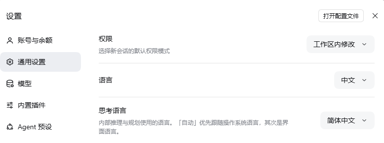

# dsh-thinking-lang

[](https://github.com/deepseek-ai/deepseek-harness)

面向 **DeepSeek Harness（dsh-desk）** 的插件：设置智能体内部推理（思考）所用的语言。

**目标环境：** DeepSeek Harness **`0.2.0-rc.2`+**（`dsh -V`）。**License：** MIT。

> **本项目的代码、文案与文档均由 DeepSeek 生成**（在人工指导下迭代产出）。它不是 DeepSeek Harness 官方组件，未经官方审核；使用前请自行阅读源码。

---

## 安装

```bash
dsh plugin --profile desktop add https://github.com/aymidasing/dsh-thinking-lang/releases/download/v1.0.2/dsh-thinking-lang-1.0.2.tgz
```

同一段地址也可以粘进设置里的插件管理器。执行前请**完全退出桌面端**：`--profile desktop` 操作的 profile 必须已经初始化，且没有进程正占用它。装完重启 GUI。

`main` 分支只有 TypeScript 源码；`lib/` 与 `client/` 是构建产物，只随 Release 提供。

**更新**：换用新版本的附件地址重装一次。依赖是以 URL 记录的，`pnpm update` 对它无效。

**卸载**：

```bash
dsh plugin --profile desktop remove dsh-thinking-lang
```

设置里的「思考语言」那一行随之消失，提示词也不再注入。和安装一样，要在桌面端完全退出后执行。

从源码装（开发用）：

```bash
npm install
npm run build
dsh plugin --profile desktop add "$PWD"
```

**语言约束对新会话生效**；切语言本身在已有会话的下一轮就生效。

> **不要再用 `github:` 安装。** pnpm 11 默认拦下依赖的构建脚本，而 `github:` 源要靠 `prepare` 才产出 `lib/` 与 `client/`，安装会停在 `ERR_PNPM_GIT_DEP_PREPARE_NOT_ALLOWED`，除非在 profile 的 `pnpm-workspace.yaml` 里逐名放行 `allowBuilds`。Release 附件是构建好的成品，装它不需要任何构建授权。

---

## 它做什么



在**设置 → 通用**里新增一行「思考语言」，位于宿主自身的语言设置项下方。整行只有一个下拉框：

| 配置项 | 取值 | 作用 |
|--------|------|------|
| **思考语言** | 自动 / 简体中文 / 繁體中文 / English | 内部推理与规划所用的语言 |

### `auto` 是怎么判定的

选「自动」时，按顺序取**第一个**能映射到语言目录的来源：

| 顺序 | 来源 | 取值方式 |
|---|---|---|
| 1 | **操作系统语言** | POSIX 环境变量 `LC_ALL` / `LC_MESSAGES` / `LANG`；Windows 上这些通常为空，改用 `Intl.DateTimeFormat().resolvedOptions().locale`（跟随系统区域设置） |
| 2 | **DSH 界面语言** | 设置服务里 `locale` 命名空间的 `preference` 字段 |
| 3 | **兜底** | 硬编码的 `zh-CN`（`FALLBACK_TAG`） |

标签先被清洗成 BCP-47（`_`→`-`，去掉 `.UTF-8`、`@latin` 这类 POSIX 修饰），再交给平台自带的 `Intl.Locale` 拆成语言／文字／地区三段，**不手写标签文法**。查找从最具体到最一般：完整标签 → 带文字的 → 带地区的 → 裸主标签，所以 `en-GB` 会落到 `en`。

中文是唯一的例外——两个条目共用 `zh` 这个主标签，决定简繁的是**文字**而不是地区。这部分交给 CLDR：`maximize()` 会把短标签省略的文字补出来，`Hant` 判为繁體、其余判为简体。于是 `zh-TW`/`zh-HK`/`zh-MO`/`zh-Hant` 都是繁體，`zh`/`zh-SG`/`zh-Hans` 都是简体，两张对照表都不需要。

| 系统 | 界面 | 结果 |
|---|---|---|
| `zh-CN` | `en-US` | 简体中文 |
| `en-US` | `zh-CN` | English |
| `fr-FR`（目录里没有） | `en-US` | English（落到下一级） |
| 取不到 | 取不到 | 简体中文 |

在下拉里**显式选了某个语言**时，那个选择优先于上面全部三级，与系统/界面语言无关。

---

## 提示词是怎么注入的

规则用**所选语言本身**书写（不是英文语言名），分两个位置注入——区别在**频率**：

| | `systemPrompt.section` | `agent/pre-step` 提醒 |
|---|---|---|
| 由谁生成 | [`sectionText`](src/core.ts) | [`reminderText`](src/core.ts) |
| 内容 | 完整规则句 | 一句短提醒 |
| 注入形态 | 系统提示词的一段 | 一条 user 消息，追加在请求末尾 |
| 频率 | 每会话组装一次（文本变化时提交） | 每轮第一步，且距上次 ≥10 分钟 |
| 顺序 | `order: 1`，紧跟 persona | `prepend` 注册，晚于其它 pre-step 注入 |

### 实际注入的文本

文本由 [`src/core.ts`](src/core.ts) 的 `CATALOGUE` 提供，每种语言一份、**用该语言书写**：

| 语言 | section（规则句） | reminder（每轮提醒） |
|---|---|---|
| 简体中文 | 推理规则：思考、推理与规划一律使用简体中文。回复用户时使用用户所用的语言。 | 继续用简体中文思考、推理与规划。 |
| 繁體中文 | 推理規則：思考、推理與規劃一律使用繁體中文。回覆使用者時使用使用者所用的語言。 | 繼續用繁體中文思考、推理與規劃。 |
| English | Reasoning rules: think, reason, and plan in English. Reply to the user in the language they use. | Keep thinking, reasoning, and planning in English. |

改文本改 `CATALOGUE`，再 `npm run build`。

这个拆分带来两个直接结果：

1. **section 是权威版本** —— 位于 persona 之后、所有工具说明之前；切语言后由宿主按文本变化提交。
2. **pre-step 提醒负责实时性** —— 追加在 `decision.messages` 末尾，落在 runtime-context、skill catalog、time-context 之后，是请求里最后的内容。

> 上一版把提醒塞进 `systemPrompt.context`：它随 runtime-context 快照走，只在快照内容变化时追加，稳定期会沉到历史深处。现在改成独立消息、按轮注入。

### 顺序与优先级

- section 的 `order: 1` 紧跟在宿主的 persona 之后、第一个策略段之前——也就是渲染出来的 persona 那句话的下一行。
- 提醒消息排在请求最末。`prepend` 让本监听器先于其它 pre-step 监听器执行，其 append 发生在链返回之后，因此晚于 time-context 等注入。

> 取值依据是 DSH 自己的分段表：`@deepseek-ai/dsh-system-prompt` 里的 `SECTION_ORDERS`——身份 `-1000`、部署 persona `0`、`PLAN_POLICY` `500`、工具段从 `1000` 起。`order: 1` 正好落在 persona 与第一个策略段之间。

---

## Token 开销（实测）

用 DeepSeek V4 词表实测（不计特殊 token）：

| 语言 | section | reminder |
|---|---|---|
| 简体中文 | 21 | 10 |
| 繁體中文 | 22 | 10 |
| English | 23 | 10 |

section 每会话一次；reminder 每轮最多一条（10 分钟内不重复），100 轮约 1000 token。**换语言对每轮开销几乎没有影响**。

---

## ⚠️ 切换语言的缓存代价

DeepSeek 的上下文缓存自动生效、无需改代码，但它**只认从第 0 个 token 起完全相同的前缀**——官方原话：「只有当两个请求的前缀内容相同时（从第 0 个 token 开始相同），才算重复。**中间开始的重复不能被缓存命中**。」（[API 上线硬盘缓存](https://api-docs.deepseek.com/zh-cn/news/news0802/)）

切语言会改变 section 文本，影响范围取决于宿主如何处理 system prompt 更新：

- **支持 in-history 的模型**（DeepSeek 官方模型声明 `systemPromptUpdate: 'in-history'`）：新 system prompt 作为一条消息追加到历史尾部，旧前缀仍可命中；
- **其它模型**：宿主替换开头那条 system message，从那里往后的 Token 全部重算。

reminder 每轮追加在请求末尾，只新增尾部 Token，不会让已有前缀失效。

差价是 **50 倍**（`deepseek-flash` 空闲时段：命中 0.02 元 / 百万 token，未命中 1 元 / 百万 token；高峰时段同样 50 倍。见[模型 & 价格](https://api-docs.deepseek.com/zh-cn/quick_start/pricing/)）。切换的代价仍是一次性的，从下一轮起恢复命中。

**实用建议**：选定一种语言就别频繁来回切，尤其别在一轮对话中间切。切换不影响正确性，只影响钱。

---

## 构建

```bash
npm install
npm run check     # typecheck + build
```

构建分两段：

1. `tsc -p tsconfig.json` 编译宿主端到 `lib/`；
2. tsdown 把客户端打成 **CommonJS** 到 `client/client.raw.cjs`，再由 [`scripts/wrap-client-bundle.mjs`](scripts/wrap-client-bundle.mjs) 套上 DSH 的 `__ModuleLoader__` 工厂外壳，输出 `client/client.js`。

选 CommonJS 是为了让产物天生就是 `require(...)` 形态——DSH 的客户端工厂只提供 `require`，若先打成 ESM 就还得事后用正则把导入语句改回来。

Node（构建）需要 `^22.18.0 || >=24.11.0`；插件运行时不依赖本机 Node。

打包与发版：`npm pack` 产出 `dsh-thinking-lang-<version>.tgz`（`prepack` 会先构建），[`scripts/verify-pack.mjs`](scripts/verify-pack.mjs) 校验它带着运行时要加载的文件。发版流程是改 [`package.json`](package.json) 的 `version` → 提交 → `git tag v<version>` → 推送 tag；工作流会构建、校验并把附件传到该 tag 的 Release，tag 与 `version` 不一致时直接失败。

---

## 目录结构

| 路径 | 说明 |
|------|------|
| [`src/core.ts`](src/core.ts) | 语言目录、配置归一化、两份提示词生成。**纯函数，无宿主依赖**，客户端与宿主端共用。locale 解析走平台自带的 `Intl.Locale` |
| [`src/index.ts`](src/index.ts) | 宿主入口：Config schema、section 与 pre-step 提醒注册、语言解析（含操作系统语言探测） |
| [`src/client/index.ts`](src/client/index.ts) | 客户端入口：在 `settings.general.item` 插槽注册设置行 |
| [`src/client/panel.ts`](src/client/panel.ts) | 单行设置控件与样式 |
| [`src/client/locales.ts`](src/client/locales.ts) | 三套行文案（简 / 繁 / 英） |
| [`cordis.patch.yml`](cordis.patch.yml) | bundle patch，登记宿主入口 |
| [`PROVENANCE.md`](PROVENANCE.md) | 设置行样式的来源记录，以及从 `app.asar` 读宿主源码的方法（维护用） |
| `lib/` · `client/` | 构建产物，**不入库**——只随 Release 附件提供；[`package.json`](package.json) 的 `files` 白名单负责把它们打进包 |
| [`.github/workflows/release.yml`](.github/workflows/release.yml) | tag 触发：构建、校验、上传 Release 附件 |
| [`scripts/verify-pack.mjs`](scripts/verify-pack.mjs) | 校验附件里带着运行时要加载的文件（构建链的看门人） |
| [`assets/`](assets/) | README 用的截图；GitHub 直接渲染，不随 npm 包发布 |

### 依赖面

| 类型 | 包 | 说明 |
|---|---|---|
| 运行时 | `@deepseek-ai/schemastery` | DSH 的设置 schema 格式，`export const Config` 必需 |
| 构建期 | `typescript` · `tsdown` · `@types/node` | 只在 `npm run build` 时用到 |
| 宿主提供 | `@deepseek-ai/dsh-client-ui-primitives` | 客户端用 `tryRequire` 按需取用；宿主没有时降级为原生控件 |

**不依赖任何 DSH 类型包。** 宿主上下文由 [`src/index.ts`](src/index.ts) 里的本地 `HostContext` 接口结构化描述，所以包里没有 `@deepseek-ai/cordis`（既不是 dependency 也不是 peerDependency）。

宿主端对包只暴露四个导出：`name`、`inject`、`Config`、`apply`——其余全部是模块内私有。

### 设置行文案的语言（预留功能，默认关闭）

设置行的文案**可以**跟随思考语言而不是界面语言——选 繁體中文，这一行的标题与说明就变繁体。整套机制已经实现并接线完毕，但**当前不生效**。

| | |
|---|---|
| 开关 | [`src/client/locales.ts`](src/client/locales.ts) 里的 `COPY_FOLLOWS_THINKING_LANGUAGE`，默认 `false` |
| 启用 | 改成 `true` → `npm run build` → 重启 GUI |
| 还要改别的文件吗 | 不用。三套字典与选取函数 `dictionaryFor` 都在 `locales.ts` 里 |

因为开关是编译期常量，构建时 rolldown 会把这条死分支连同繁体字典一起摇掉——当前产物里没有这些文案，行为与「只跟随界面语言」完全一致。语言选择器的选项始终显示各语言的本族语名（简体中文 / English），所以即使文案换成了你不熟悉的语言，也能从同一个下拉里切回来。

---

## 已知限制

- **section 的位置绑住宿主的分段表**：`order: 1` 取自 `@deepseek-ai/dsh-system-prompt` 的 `SECTION_ORDERS`（persona `0`、`PLAN_POLICY` `500`）。宿主若调整那张表，改 [`src/index.ts`](src/index.ts) 的 `SECTION_ORDER`。
- **设置行的位置绑住宿主语言项的 order**：宿主语言行注册在 `order: 0`（`@deepseek-ai/dsh-client-locale`），本插件用 `order: 1` 紧贴其后。宿主若调整，改 [`src/client/index.ts`](src/client/index.ts) 的 `ROW_ORDER` 即可。
- **只支持三种思考语言**：简体中文、繁體中文、English。要增删语言，改 [`src/core.ts`](src/core.ts) 的 `CATALOGUE`，并在 [`src/client/locales.ts`](src/client/locales.ts) 补上对应文案。
- **没有聊天命令**：切换语言只走设置页。如需 `/thinking-language`，可参照 `dsh-thinking-language` 的命令实现补上。
- **`auto` 依赖运行时能报出系统语言**：Linux/macOS 走环境变量，Windows 走 `Intl`。两者都拿不到时会静默落到界面语言，再不行才是 `zh-CN`——顺序与取值方式见上文「`auto` 是怎么判定的」。
- **插件 id 与设置命名空间**：两者都是 `ay-dsh-tk-lang`，占的是一套自有命名；包名 `dsh-thinking-lang` 与 `dsh-thinking-language` 这类仍然相似，注意区分。不过功能重复的插件同时装上，设置页会各插一行、各自注入提示词，功能上仍是重复的。

---

## License

MIT，见 [LICENSE](LICENSE)。
