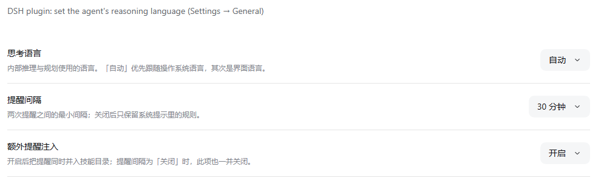

# dsh-thinking-lang

[](https://github.com/deepseek-ai/deepseek-harness)

面向 **DeepSeek Harness（dsh-desk）** 的插件：设置智能体内部推理（思考）所用的语言。

**目标环境：** DeepSeek Harness **`0.2.0-rc.2`+**（`dsh -V`）。**License：** MIT。

> **本项目的代码、文案与文档均由 DeepSeek 生成**（在人工指导下迭代产出）。它不是 DeepSeek Harness 官方组件，未经官方审核；使用前请自行阅读源码。

---

## 它做什么

在**设置 → 通用**里新增一行「思考语言」，并在**插件页 → 本插件详情**里提供同一份配置。两处读写同一份设置：

| 配置项 | 取值 | 作用 |
|--------|------|------|
| **思考语言** | 自动 / 简体中文 / 繁體中文 / English | 内部推理与规划所用的语言 |
| **提醒间隔** | 关闭 / 每轮 / 10 / 30 / 60 分钟 / 自定义 1–1440 | 两次「用该语言思考」提醒之间的最小间隔，默认 **30 分钟** |
| **额外提醒注入** | 开启 / 关闭 | 开启时把提醒同时并入技能目录那段上下文；提醒间隔为「关闭」时此项一并停用。默认开启 |

「关闭」停止全部注入，只保留系统提示里的规则；「每轮」是每个对话轮次的第一步都提醒一次。


*截图：设置 → 通用里的「思考语言」行，紧贴在宿主自己的界面语言下方。*



*截图：插件页 → 本插件详情里的同一份配置，含「提醒间隔」的预设与自定义输入，以及「额外提醒注入」开关。*

### 效果与限制

注入提高的是概率，不是保证。用户消息本身就用的所选语言时基本没问题；**用户消息首行不是所选语言**（英文开场、纯图片、只有附件）时实测：

| 做法 | 按所选语言思考的比例 |
|---|---|
| 系统提示 + 前置提醒（默认） | 约 **30%** |
| 再开启「额外提醒注入」 | 约 **70%** |

额外注入本身多花约 6 token（简体中文），换来请求尾部一次强提醒。

**如果目标是稳定拿到目标语言的思考内容**，用官方的思考过程翻译插件更合适：它把思考内容翻译后显示，代价是每次都要多付一遍翻译的 token。本插件只在「直接改思考语言、并接受大多数时候是它」这个场景下更省。

### 「自动」怎么判定

选「自动」时，按顺序取**第一个**能映射到语言目录的来源：

| 顺序 | 来源 | 取值方式 |
|---|---|---|
| 1 | **操作系统语言** | POSIX 环境变量 `LC_ALL` / `LC_MESSAGES` / `LANG`；Windows 上这些通常为空，改用系统区域设置 |
| 2 | **DSH 界面语言** | 设置里 `locale` 命名空间的 `preference` 字段 |
| 3 | **兜底** | `zh-CN` |

在下拉里**显式选了某个语言**时，那个选择优先于上面全部三级，与系统/界面语言无关。

---

## 安装与卸载

```bash
dsh plugin --profile desktop add dsh-thinking-lang
```

也可以把包名贴进设置里的插件管理器。执行前**完全退出桌面端**：`--profile desktop` 操作的 profile 不能被占用；装完重启 GUI。

**更新**：设置 → 插件里点「更新」，或重复上面那条命令。

**卸载**：

```bash
dsh plugin --profile desktop remove dsh-thinking-lang
```

设置里的「思考语言」行随之消失，提示词也不再注入；同样要在桌面端完全退出后执行。

**语言约束对新会话生效**；切语言本身在已有会话的下一轮就生效。

---

## 开发与实现细节

构建与发版、提示词注入机制、Token 开销、缓存影响、目录结构和已知限制，见 [DEVELOPMENT.md](DEVELOPMENT.md)。

---

## License

MIT，见 [LICENSE](LICENSE)。
